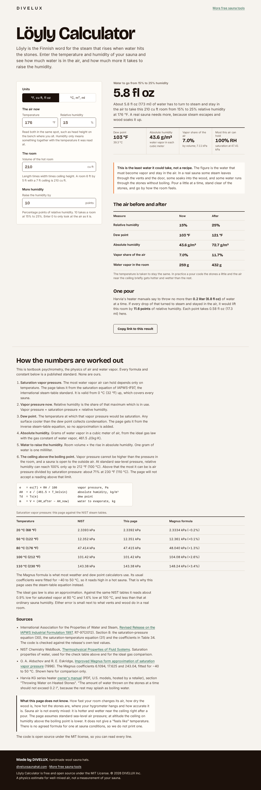
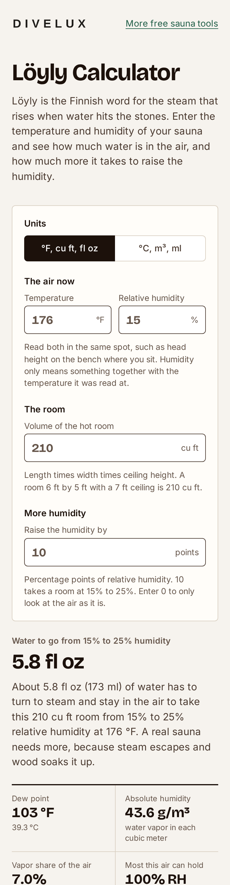

# Löyly Calculator

A free, open-source sauna humidity calculator. Löyly is the Finnish word for the steam that rises when water hits the stones.

Enter the temperature and relative humidity of the hot room. The page gives the **dew point**, the **absolute humidity** in grams of water per cubic meter, and the share of the air that is water vapor. Add the room volume and it works out **how much water has to evaporate** to raise the humidity by a given number of points.

Made by [DIVELUX](https://diveluxsaunahat.com), a small family brand in Irvine, California that makes handmade wool sauna hats.





> **This is the least water it could take, not a recipe.** The figure is the water that must become vapor and stay in the air. In a real sauna some steam leaves through the vents and the door, some soaks into the wood, and some water runs through the stones without boiling. Pour a little at a time and stand clear of the stones.

## What it does

- Temperature in °F or °C, room volume in cu ft or m³, water in fl oz and ml
- Dew point, absolute humidity (g/m³), vapor pressure and the vapor share of the air
- Water needed to raise the relative humidity by any number of points, with the air before and after side by side
- What one 0.2 liter pour would do in this room if all of it stayed in the air
- Knows the physical ceiling: above the boiling point, relative humidity cannot reach 100% in a room that is open to the outside air
- A link that reopens the same result, and plain error messages when a number is missing or impossible

No build step, no framework, no tracking, no cookies. Three small files. The only outside request is for two web fonts; if that fails the page uses system fonts.

It does not print a "feels like" temperature. There is no agreed formula for one at sauna conditions, so the page leaves it out.

## Run it

Open `index.html` in a browser. Or serve the folder:

```sh
python3 -m http.server 8000
# then open http://localhost:8000
```

To publish on GitHub Pages: push this folder to a repository, then Settings → Pages → Deploy from a branch → `main` / root. The `.nojekyll` file is already here.

Before you publish under your own address, replace `https://divelux.github.io/sauna-humidity-calculator/` in `index.html` (canonical, Open Graph, JSON-LD).

## Files

| File | What it is |
| --- | --- |
| `index.html` | The page: form, result, method notes, sources, footer |
| `style.css` | All styles. Every class starts with `dvx-` or `shu-` |
| `humidity.js` | The physics. Pure functions, no DOM. Works in Node too |
| `app.js` | The interface |
| `test.js` | Checks the equations against the IAPWS test values and the NIST steam tables, and across 4,725 air and room combinations |

## How the numbers are worked out

This is textbook psychrometry. Every formula and constant is a published standard. None are ours.

```
e   = es(T) × RH / 100            vapor pressure, Pa
AH  = e / (461.5 × T_kelvin)      absolute humidity, kg/m³
Td  = Ts(e)                       dew point
m   = V × (AH_after − AH_now)     water to evaporate, kg
```

1. **Saturation vapor pressure `es(T)`** is the saturation-pressure equation of IAPWS-IF97, the international industrial steam-table standard: Eq. (30) with the ten coefficients of Table 34. It is valid from 0 °C to the critical point of water.
2. **Dew point `Ts(e)`** is the inverse equation of the same standard, Eq. (31). The two are exact inverses of each other, so no extra approximation is added. If the air is so dry that the dew point is below 0 °C, the page says "below 32 °F" and does not guess.
3. **Absolute humidity** is the ideal gas law with the gas constant of water vapor, 461.5 J/(kg·K). That is the universal gas constant, 8.314462618 J/(mol·K), divided by the molar mass of water, 0.01801528 kg/mol.
4. **Water to raise the humidity** is room volume × the rise in absolute humidity, with the temperature held the same. One gram of water is one milliliter to within 0.3%.
5. **The ceiling above the boiling point.** Vapor pressure cannot be higher than the pressure in the room. At standard sea-level pressure (101.325 kPa) relative humidity can reach 100% only up to 99.97 °C. Above that the most it can be is 101.325 kPa ÷ saturation pressure: 70.7% at 110 °C (230 °F), 51.0% at 120 °C (248 °F). The page refuses a reading above that limit.
6. **One pour.** Harvia's heater manuals say "the amount of water thrown on the stones at a time should not exceed 0.2 l". The page shows how many points of humidity 0.2 l would add if every drop stayed in the air as vapor.

### Why not the Magnus formula?

Most weather and dew point calculators use the Magnus formula. Its usual coefficients (Alduchov and Eskridge 1996: 6.1094 hPa, 17.625, 243.04 °C) were fitted for −40 to 50 °C. In a hot sauna it reads high. `humidity.js` keeps a `magnus()` function only so the difference can be shown and tested.

| Temperature | NIST steam tables | This page (IAPWS-IF97) | Magnus formula |
| --- | --- | --- | --- |
| 20 °C (68 °F) | 2.3393 kPa | 2.3392 kPa | 2.3334 kPa (−0.2%) |
| 50 °C (122 °F) | 12.352 kPa | 12.351 kPa | 12.361 kPa (+0.1%) |
| 80 °C (176 °F) | 47.414 kPa | 47.415 kPa | 48.040 kPa (+1.3%) |
| 100 °C (212 °F) | 101.42 kPa | 101.42 kPa | 104.08 kPa (+2.6%) |
| 110 °C (230 °F) | 143.38 kPa | 143.38 kPa | 148.24 kPa (+3.4%) |

### How good is the ideal gas law here?

Against the vapor densities in the same NIST tables, the ideal gas law reads 0.9% low for saturated vapor at 80 °C and 1.6% low at 100 °C. At ordinary sauna humidity the vapor is far from saturation and the difference is smaller. `test.js` checks this at twelve temperatures.

### Worked example (checked in `test.js`)

A 210 cu ft (5.95 m³) room at 176 °F (80 °C) and 15% relative humidity, raised by 10 points:

- Saturation pressure at 80 °C: 47.41 kPa. Vapor pressure at 15%: 7.11 kPa.
- Dew point: 39.3 °C (103 °F). Absolute humidity: 43.6 g/m³. Vapor is 7.0% of the air by volume.
- One point of humidity is 2.91 g/m³, or 17.3 g of water in this room. Ten points: **173 ml (5.8 fl oz)**.
- A 0.2 l pour would add 11.6 points if all of it stayed in the air.

## Sources

All checked in November 2026.

- International Association for the Properties of Water and Steam, [Revised Release on the IAPWS Industrial Formulation 1997 for the Thermodynamic Properties of Water and Steam](https://iapws.org/technical-guidance/release/IF97-Rev), IAPWS R7-97(2012). Section 8: Eq. (30), Eq. (31), Table 34, and the verification values in Tables 35 and 36 that `test.js` reproduces.
- NIST Chemistry WebBook, [Thermophysical Properties of Fluid Systems](https://webbook.nist.gov/chemistry/fluid/). Saturation properties of water from 10 to 120 °C: pressure and vapor density.
- O. A. Alduchov and R. E. Eskridge, [Improved Magnus form approximation of saturation vapor pressure](https://www.osti.gov/biblio/548871), Journal of Applied Meteorology 35 (1996), 601–609. The coefficients 6.1094, 17.625, 243.04 and the fitted range of −40 to 50 °C.
- Harvia KG series heater [owner's manual](https://cdn.shopify.com/s/files/1/0561/1221/8302/files/Harvia_Club.pdf) (PDF, U.S. models K10G to K15G, hosted by a retailer), section 1.4 "Throwing Water on Heated Stones". The 0.2 l limit per pour, and the warning that excess water "may splash as boiling hot water on the bathers".

## What it does not know

How fast your room changes its air, how dry the wood is, how hot the stones are, where your hygrometer hangs and how accurate it is. Sauna air is not evenly mixed: it is hotter and wetter near the ceiling right after a pour. The page assumes standard sea-level air pressure; at altitude the ceiling on humidity above the boiling point is lower. The temperature is taken to stay the same while the humidity rises.

Nothing here is health or medical advice.

## Use the physics in your own code

```js
const H = require('./humidity.js');

H.satPressure(80);            // 47414.7 Pa
H.satTemp(101325);            // 99.974 °C
H.maxRH(110);                 // 70.67 %

const r = H.calc({ tempC: H.f2c(176), rh: 15, volume: H.cuftToM3(210), raise: 10 });
// r.now   { rh: 15, vaporKPa: 7.11, dewPointC: 39.3, dewPointF: 103, absGm3: 43.6, vaporSharePct: 7 }
// r.water { grams: 173, ml: 173, flOz: 5.8, gramsPerPoint: 17.3, flOzPerPoint: 0.58 }
// r.ladle { ml: 200, flOz: 6.8, points: 11.6, overflows: false }
```

Temperatures are °C and volumes are m³; the helpers convert.

## Tests

```sh
node test.js
```

## Credit and license

Made by [DIVELUX](https://diveluxsaunahat.com), handmade wool sauna hats. More free sauna tools: <https://diveluxsaunahat.com/pages/sauna-tools>

MIT License, © 2026 DIVELUX Inc. See [LICENSE](LICENSE).
